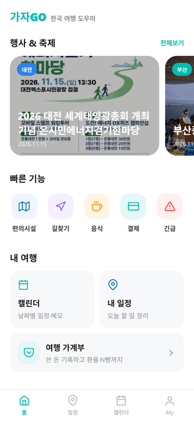
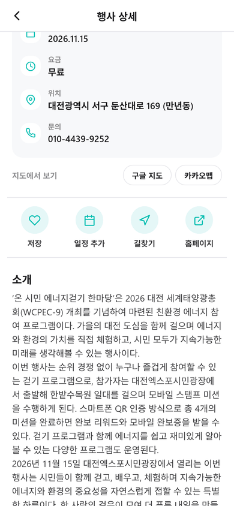
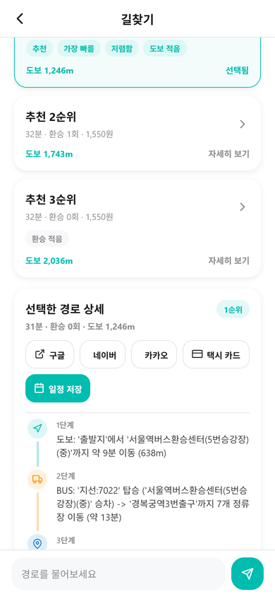
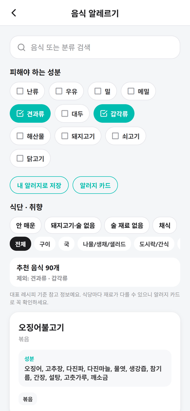
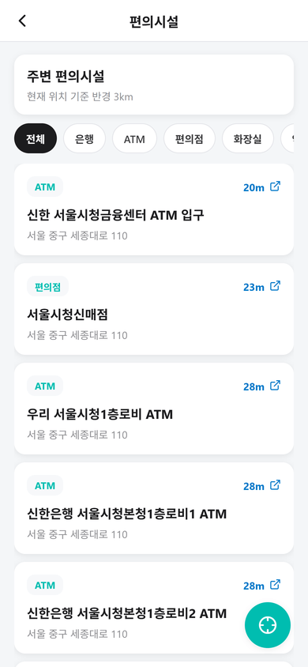
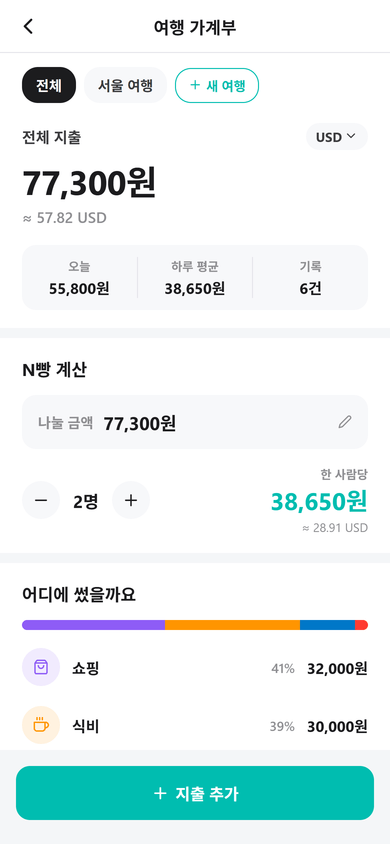
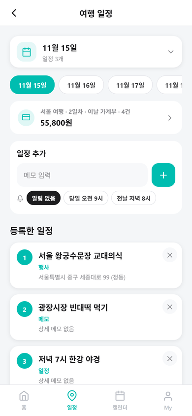
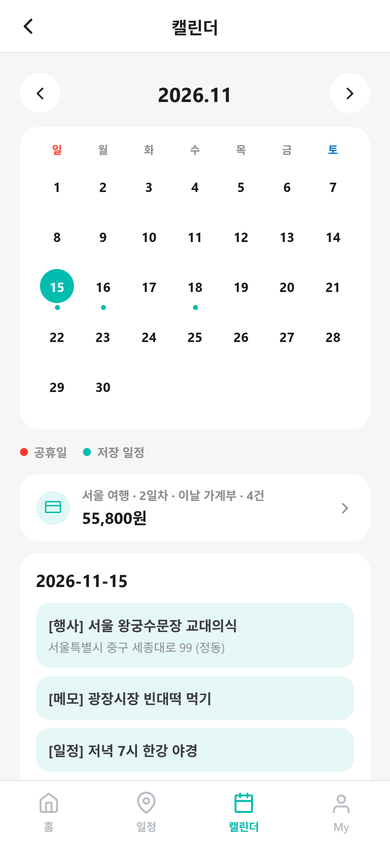
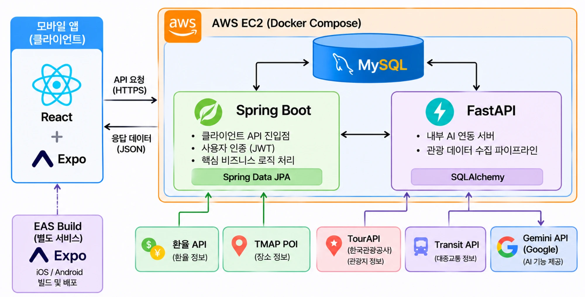

<p align="center">
  
</p>

<h2 align="center">가자GO</h2>

<p align="center">
  <b>AI 자연어 이해 · 실시간 대중교통 경로 · 지역 행사 정보를 연결한 외국인 한국 여행 지원 모바일 앱</b>
</p>

<p align="center">
  
  
  
  
</p>

---

## Overview

| 항목 | 내용 |
| --- | --- |
| 서비스 목표 | 외국인 여행자가 한국 여행 중 필요한 행사, 교통, 음식, 편의시설, 일정, 경비를 하나의 앱에서 확인할 수 있도록 지원 |
| 핵심 흐름 | 홈 → 행사 탐색 → 교통 챗봇 경로 추천 → 일정·캘린더 저장 → 여행 가계부 |
| 차별점 | Gemini 자연어 분석과 실제 대중교통 데이터(TMAP, 실패 시 카카오)를 연결해 이동 가능한 경로를 추천 |
| 사용자 가치 | 회원가입 없이 바로 쓰고, 저장이 필요할 때만 로그인하는 모바일 여행 도우미 |

---

## 1. 프로젝트 소개

가자GO는 한국을 방문한 외국인이 여행 중 자주 겪는 정보 탐색 문제를 하나의 모바일 앱에서 해결하기 위해 만든 서비스입니다.

홈 화면에서 행사와 빠른 기능을 탐색하고, 자연어 교통 챗봇으로 이동 경로를 추천받으며, 음식 알레르기 성분을 필터링하고, 일정과 여행 경비를 함께 관리할 수 있습니다.

### 핵심 가치

- 여행 중 필요한 행사, 교통, 음식, 편의시설, 일정, 경비를 하나의 앱에서 연결
- 자연어 입력을 실제 대중교통 경로 후보로 변환
- 알레르기 성분 기반 음식 추천으로 외국인 여행자의 안전한 식사 선택 지원
- 로그인 없이 모든 기능 사용, 저장(행사·일정·경로 기록·알레르기·가계부)할 때만 로그인

---

## 2. 시연 화면

<table>
  <tr>
    <td align="center"><br /><b>홈</b></td>
    <td align="center"><br /><b>행사 상세</b></td>
    <td align="center"><br /><b>교통 챗봇 경로</b></td>
    <td align="center"><br /><b>음식 알레르기</b></td>
  </tr>
  <tr>
    <td align="center"><br /><b>주변 편의시설</b></td>
    <td align="center"><br /><b>여행 가계부</b></td>
    <td align="center"><br /><b>내 일정</b></td>
    <td align="center"><br /><b>캘린더</b></td>
  </tr>
</table>

| 화면 | 시연 내용 |
| --- | --- |
| 홈 | 행사 & 축제 배너, 빠른 기능(편의시설·길찾기·음식·결제·긴급), 캘린더·일정·가계부 진입 |
| 행사 상세 | 기간·요금·위치·문의·소개 확인, 구글 지도·카카오맵 보기, 저장·일정 추가·바로 길찾기 |
| 교통 챗봇 | "서울역에서 경복궁까지 짐이 많은데 어떻게 가?" 같은 자연어 요청 → 1~3순위 경로와 단계별 이동 |
| 음식 알레르기 | 난류, 우유, 밀, 메밀, 견과류, 갑각류 등 제외 성분 선택 후 안전한 음식 목록 |
| 주변 편의시설 | 현재 위치 3km 안 은행·ATM·편의점·화장실·약국·지하철역·환전소 |
| 여행 가계부 | 여행별 지출 기록, 10개 통화 환율 환산, N빵 계산, 영수증 이미지 공유 |
| 일정·캘린더 | 날짜별 일정·메모 저장, 등록할 때 고르는 알림, 날짜별 지출 합계 |

---

## 3. 주요 기능

### 행사 & 축제 탐색

- 한국관광공사 TourAPI 축제 데이터를 서버가 매일 자동으로 갱신합니다.
- 지역과 진행 상태를 기준으로 행사 목록을 필터링합니다.
- 행사 상세에서 지도 보기, 저장, 일정 추가, 행사장까지 바로 길찾기를 할 수 있습니다.

### AI 교통 경로 추천

- 자연어로 이동 상황을 입력하면 Gemini가 출발지, 목적지, 조건(짐, 보행, 환승 등)을 추출합니다.
- 출발지를 말하지 않으면 현재 위치에서 출발합니다.
- TMAP 대중교통 데이터로 경로 3개를 받고, TMAP이 실패하면 카카오 대중교통 경로로 다시 검색합니다.
- 조건을 반영한 추천 순위와 이유, 단계별 이동을 보여주고 카카오맵·네이버지도·구글 지도로 이어집니다.

### 음식 알레르기 필터링

- 피해야 할 성분을 선택하면 해당 성분이 들어간 음식을 제외한 목록을 추천합니다.
- 안 매운 음식, 돼지고기·술 없음, 채식 같은 식단 필터를 함께 쓸 수 있습니다.
- 알러지·택시·도움 요청 카드를 한국어 큰 글씨로 보여줄 수 있습니다.
- 회원은 내 알레르기를 저장해 다음에 자동으로 적용합니다.

### 주변 편의시설 탐색

- 현재 위치 기준 반경 3km의 편의시설을 카테고리별·거리순으로 조회합니다.

### 일정 · 캘린더 · 알림

- 행사, 교통 경로, 직접 입력한 메모를 날짜별 일정에 저장합니다.
- 일정을 등록할 때만 알림(당일 오전 9시 / 전날 저녁 8시)을 고를 수 있습니다.

### 여행 가계부

- 여행(이름·기간)별로 지출을 기록하고 10개 통화로 환산해 봅니다.
- N빵 계산과 기간을 고른 영수증 이미지 공유를 지원합니다.
- 비회원도 사용할 수 있으며, 회원은 서버에 저장됩니다.

---

## 4. 기술 스택

| 영역 | 기술 |
| --- | --- |
| Mobile Frontend | React Native, Expo, TypeScript |
| Navigation | React Navigation |
| Storage | AsyncStorage |
| Device | Expo Location, Expo Notifications, react-native-view-shot |
| Auth | JWT Authentication |
| Backend API | Spring Boot API |
| AI / Transport API | FastAPI, Gemini, TMAP, Kakao Map |
| Infra | AWS EC2, Docker Compose |
| Build | EAS Build |

---

## 5. 시스템 아키텍처

<p align="center">
  
</p>

프론트엔드는 `EXPO_PUBLIC_API_BASE_URL`에 설정된 서버 주소를 기준으로 API를 호출합니다.

- 공통 API 클라이언트: `src/app/api/client.ts`
- 인증 토큰 저장소: AsyncStorage
- 인증 요청 방식: `Authorization: Bearer <token>` (비회원 요청은 토큰 없이 호출)
- 기능별 API 모듈: `auth`, `festival`, `food`, `facilities`, `transport`, `userContent`

---

## 6. 프로젝트 구조

```text
src/app
├── api              # 백엔드 API 호출 모듈
├── components       # 공통 UI 및 기능별 컴포넌트 (expense, transport, food ...)
├── data             # 화면용 정적 데이터와 정렬·필터 함수
├── hooks            # 기능별 커스텀 훅
├── screens          # 앱 화면 단위 컴포넌트
├── utils            # 날짜·지도·알림·로그인 등 공통 유틸
├── App.tsx          # 앱 진입 및 네비게이션 구성
├── routes.ts        # 라우트 이름 정의
└── theme.ts         # 색상/디자인 토큰
```

---

<p align="center">
  
</p>
